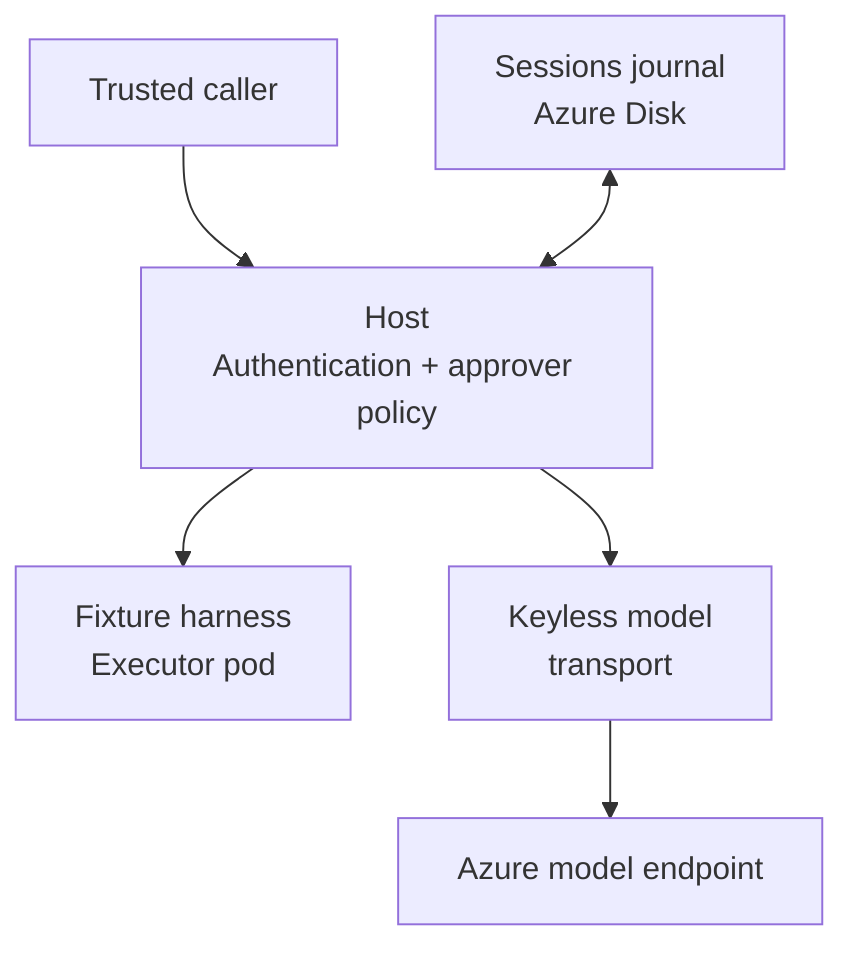

# aks-durable-agents

**Experimental source. Not for production or untrusted users. Preview 0 is not yet qualified.**

This source depends on **unreleased development versions**:

| Component | Selected development version |
| --- | --- |
| Sessions root | `github.com/agent-primitives/sessions v0.2.1-0.20261019224537-f18a2cb1454d` |
| Sessions Substrate adapter (separate module) | `github.com/agent-primitives/sessions/integrations/substrate v0.0.0-20261019224537-f18a2cb1454d` |
| Substrate runtime/client | `github.com/agent-substrate/substrate v0.4.1-0.20261013053953-96dffb287919` |

All modules use canonical upstream sources, with no fork replacements. These are
public development pins, not a released or qualified assembly. Sessions core and
its separate Substrate adapter select the same commit. The runtime/client pin
remains the adapter's compatible version; see [the version set](docs/substrate.md#version-set).

Run durable agents on an existing Azure Kubernetes Service (AKS) cluster.

[](https://github.com/Azure/aks-durable-agents/actions/workflows/ci.yml)
[](docs/preview-0.md)

For platform teams that already run AKS and want governed, durable agents without
adopting a separate control plane.

Start with offline checks. Read the [validation and security limits](#status)
before considering any deployment.

[Start offline](#getting-started) · [Architecture](docs/architecture.md) · [Documentation](docs/README.md) · [Preview 0 checklist](docs/preview-0.md)

## Why durable sessions on AKS?

An agent can pause for a person's approval without holding execution compute,
survive restarts, and leave a record of what happened.
[Sessions](https://github.com/agent-primitives/sessions) owns the journal,
approvals, zero-call replay and fork; [Agent Substrate](https://github.com/agent-substrate/substrate)
provides isolated execution and snapshots.

This repo is the thin Azure layer on top: Entra caller identity, keyless model
access through workload identity, network policy, Helm packaging and backup/restore.
It is not a new runtime.
Sessions stays cloud-neutral; this Azure layer's role mapping, supported Helm installation and approval-bound delegated tool access are planned, not current guarantees.

## Status

**Experimental, pre-release.** Public source availability is not a preview release.
The current host is a **loopback-only proof**, not governed or multi-tenant
activation. Authentication and an explicit approver policy are wired; sessions
resource authorization is not yet enforced. Do not expose the API to untrusted users.

- **Validated:** offline Go and Helm checks; local kind stopped-writer backup and
  isolated strict replay with zero model/tool calls. A separate AKS Sessions
  approval/replay proof used a fake model and unauthenticated, scripted decisions;
  it did not validate this chart or this Azure host assembly.
- **Not yet validated:** a live Entra tenant, live keyless model inference through
  this host, Substrate isolation/snapshot recovery in this assembly, or an AKS
  1.37 chart install. No HA or production-readiness claim.

The [Preview 0 checklist](docs/preview-0.md) is the acceptance bar for a **preview
release**, not a gate on public experimental source. Its unfinished requirements
remain open; publishing source does not qualify them.

## How the pieces fit

The chart's default legacy profile separates the host from a fixture
harness/executor pod:



A trusted caller reaches the host, which writes the sessions journal and calls
the fixture harness/executor. Model calls go through the host's keyless transport
to Azure; the harness gets no model credential. Both pods
share a prepared data subtree for the executor socket and durable receipts.
The chart does **not** install Substrate. Substrate owns isolated execution and
snapshots in the intended assembly; the fixture pod is not that isolation boundary.
The session API stays loopback-only and has no Service or Ingress.

An opt-in [native document producer profile](charts/aks-durable-agents/README.md#native-document-producer-profile)
replaces the fixture pod with static producers from prepared archives. It uses the
host's built-in health probe, but still needs a separately supplied producer image
and archives. Its [external qualification inputs](ops/canvas/README.md#scope-and-prerequisites)
are not distributed here; this is not a standalone public deployment.

## Repository map

| Directory | Provides |
| --- | --- |
| [`cmd/host/`](cmd/host/) | Sessions host executable; [configuration and security limits](docs/host.md). |
| [`entraauth/`](entraauth/) | Entra delegated caller verification; [trust and tenant setup](docs/entraauth.md). |
| [`modeltransport/`](modeltransport/) | Workload-identity Chat transport; [Go wiring](docs/modeltransport.md) and [bounded model policy](modeltransport/README.md). |
| [`internal/`](internal/) | Host assembly, approver policy and Unix-socket executor client. |
| [`charts/`](charts/) | Digest-pinned two-pod packaging, retained single-writer storage and NetworkPolicies. |
| [`ops/backup/`](ops/backup/) | Stopped-writer backup and isolated, socket-denied replay restore. |
| [`ops/canvas/`](ops/canvas/) | Native producer offline checks and optional external-input kind qualification. |

## Getting started

Start offline, without Azure credentials or model keys. With Python 3.14.3 and
the Go toolchain from [`go.mod`](go.mod) (currently 1.27.2), run from the repository root:

```sh
go mod download
go test ./...
python3 -B -m unittest discover -s ops/backup -p 'test_*.py'
```

For Helm lint, rendering and refusal tests, install Helm 3.20.0, Python 3.14.3
and the [pinned test requirements](charts/aks-durable-agents/tests/requirements.txt),
then follow the [offline chart checks](charts/aks-durable-agents/README.md#offline-verification).
The [local kind rehearsal](ops/backup/README.md#local-kind-rehearsal) exercises
backup/replay with a fake model. It requires Docker, kind, kubectl, Helm and
matching operator-built fixture/client binaries that are not included here.
Their source/build recipe and the tagged integration test's external JavaScript
reviewer are not distributed here either. Offline unit/chart checks are the
self-contained entry point; the chart and rehearsal are not a standalone public
distribution. See [external test inputs](docs/development.md#external-fixture-qualification).
It uses kind Kubernetes 1.32.2 with chart YAML rendered for 1.37, not a Helm install
or AKS qualification.

For an existing cluster, follow the [chart's prerequisites and policy-first install](charts/aks-durable-agents/README.md).
It targets **AKS 1.37**, Linux amd64, OIDC and workload identity, Cilium enforcement
and Azure Disk CSI. Reviewed probe-capable image digests, prepared private storage,
and identity/TLS/model-policy inputs are required; bare defaults cannot run.
The root Dockerfile alone lacks the **legacy fixture profile's** probe binary;
the native profile uses `/host health-probe` and requires its own reviewed producer
image and prepared archives.
Workloads start dormant until the operator verifies policy enforcement.
Read the [backup and restore recipe](ops/backup/README.md) before opening retained data.

## Documentation

See the [documentation index](docs/README.md),
[development checks and pull-request guidance](docs/development.md),
[host configuration and remaining authorization work](docs/host.md),
[Sessions](https://github.com/agent-primitives/sessions) and
[Agent Substrate](https://github.com/agent-substrate/substrate).

See [CONTRIBUTING.md](CONTRIBUTING.md) for the development and CLA process,
[SUPPORT.md](SUPPORT.md) for help and [SECURITY.md](SECURITY.md) for private
vulnerability reporting. Experimental source has no production support or SLA.
This source is licensed under the [MIT License](LICENSE).

## Contributing

This project welcomes contributions and suggestions.  Most contributions require you to agree to a
Contributor License Agreement (CLA) declaring that you have the right to, and actually do, grant us
the rights to use your contribution. For details, visit [Contributor License Agreements](https://cla.opensource.microsoft.com).

When you submit a pull request, a CLA bot will automatically determine whether you need to provide
a CLA and decorate the PR appropriately (e.g., status check, comment). Simply follow the instructions
provided by the bot. You will only need to do this once across all repos using our CLA.

This project has adopted the [Microsoft Open Source Code of Conduct](https://opensource.microsoft.com/codeofconduct/).
For more information see the [Code of Conduct FAQ](https://opensource.microsoft.com/codeofconduct/faq/) or
contact [opencode@microsoft.com](mailto:opencode@microsoft.com) with any additional questions or comments.

## Trademarks

This project may contain trademarks or logos for projects, products, or services. Authorized use of Microsoft
trademarks or logos is subject to and must follow
[Microsoft's Trademark & Brand Guidelines](https://www.microsoft.com/legal/intellectualproperty/trademarks/usage/general).
Use of Microsoft trademarks or logos in modified versions of this project must not cause confusion or imply Microsoft sponsorship.
Any use of third-party trademarks or logos are subject to those third-party's policies.
