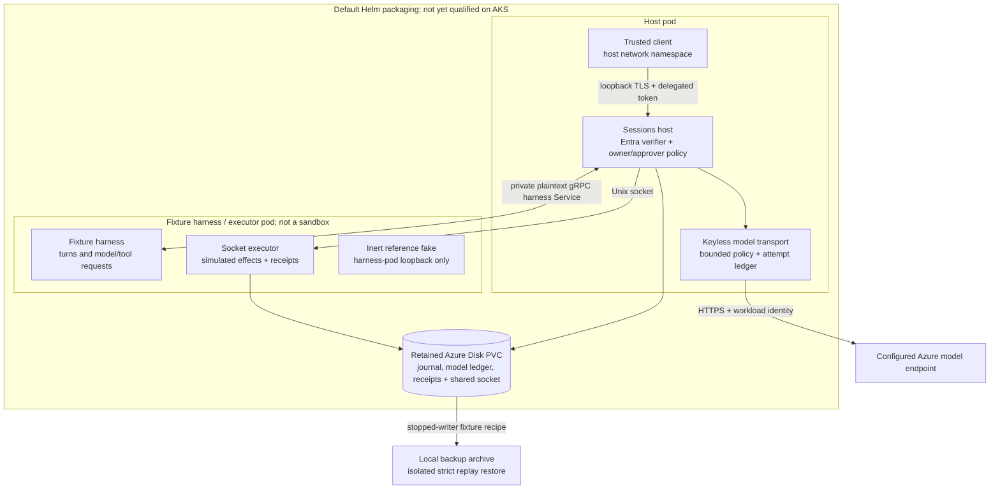
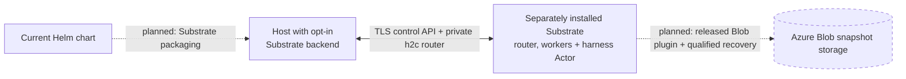

# Architecture

[Docs index](README.md) · [Project overview](../README.md)

This repository assembles Sessions with Azure identity, model transport and
operational packaging. It does not replace Sessions or provide a document store.

## Why this exists

Sessions is cloud-neutral; this repo supplies Azure-specific identity and
operations: Entra caller verification with optional role, group and member
checks, plus approval by explicit subject allowlist OR verified app role
([policy details](entraauth.md#optional-caller-and-approver-checks)), keyless model access, network policy, opt-in
Substrate wiring for isolation, and an Azure Disk-backed journal with a
backup/restore recipe tested locally on kind. Substrate isolation and
backup/restore on AKS, plus a qualified, supported Helm install, are planned—not
current guarantees. Also planned, via [sessions#127](https://github.com/agent-primitives/sessions/issues/127),
are approval-bound tool grants: approved tool calls use the approver's delegated
access through a host-side connector, without passing credentials to harnesses.

## Default chart: host and fixture harness

**Legend:** solid boxes and arrows are implemented wiring or operator recipes,
not proof of live deployment. The diagram shows required authentication mode.
The local backup drill injects a host-local HTTPS fake and fake credential instead
of Azure inference; it does not call the fixture pod's inert fake.
The host API is loopback-only, with no Service or Ingress; the chart's Service is
for the harness. The fixture pod has no external egress, but it is not Substrate
isolation. Bare chart defaults cannot run: reviewed images, prepared storage,
TLS, identity, model policy and network-policy enforcement are operator inputs.
See the [chart prerequisites](../charts/aks-durable-agents/README.md).

## Opt-in Substrate backend and planned integration

The host also implements an opt-in [Substrate backend](substrate.md), selected
instead of remote harnesses. It routes one configured stateless harness
through a TLS control API and a private h2c router into an Actor, using
operator-supplied runtime/image settings. Model transport and socket executors remain on the host
side; the Actor is not given model credentials. This host wiring exists, but the
chart above does **not** install or configure it.

Dashed arrows/boxes mark planned integration, not a current chart or recovery
capability. Substrate's snapshot store is distinct from the fixture backup
archive; there is no built-in journal-to-Blob backup path.

## Main boundaries

- **Documents:** callers such as Canvas own their document store and review; this host owns no accepted-document history.
- **Journal:** Sessions records execution, approval and replay on retained storage; the model attempt ledger and executor receipts are separate durable state. Required mode starts on a new private journal; ownerless sessions are denied to everyone, without automatic binding or migration. The durable authorization marker remains `off`: keep this journal exclusive to the enforced host, since unenforced writers bypass RPC checks.
- **Ownership:** required mode installs `WithAuthorization`, captures the verified caller on Create/implicit Exec creation and requires the owner for ordinary operations. Listing is natively owner-only. Required-mode Fork is refused; no operator role is added.
- **Approvals and reads:** a listed subject OR a verified approver app role grants `GetSession`, `Replay` and `Approve` on any valid owned session, not other cross-owner operations. Ownership does not grant approval. Configured approver roles require a usable `roles` claim even for listed subjects on approval/shared-read checks, with no fallback. Ordinary owner operations do not require approver roles. Approvers can read full prompts, outputs and tool arguments. They need the UID out of band; there is no cross-owner list, inbox or notifier. See [response disclosure](host.md#read-disclosure-and-rollout). Approve records only the decision, with no implicit Resume.
- **Human identity:** required mode enforces host-RPC permissions, not journal-wide policy or server-derived approval attribution/caller-bound retries. Provenance `IdentityRef` is not the stored authorization owner. `auth.mode=off` is unchanged: anyone reaching that host may read, act and approve. No untrusted or multi-tenant access is supported.
- **Model access:** only the host's transport uses workload identity for Azure inference; harnesses receive model results, not Azure credentials.
- **Execution:** the chart's fixture pod is not a sandbox; opt-in Substrate wiring needs separate infrastructure and has no boot-scoped recovery-authority guarantee.
- **Recovery:** fence all writers and restore journal, receipts and model ledger as one set; the fixture recipe is not Actor snapshot recovery or Canvas whole-state backup.

Required-mode deployment needs a published, verified and pinned image containing
the host authorization change; a current digest alone does not establish it.
Loopback/TLS and NetworkPolicy restrictions remain unchanged.

Live tenant/keyless-inference validation, this chart's AKS install, signed-in
resource authorization and AKS recovery remain [Preview 0 gates](preview-0.md).
There is no HA, production-readiness or tamper-proof audit claim.
